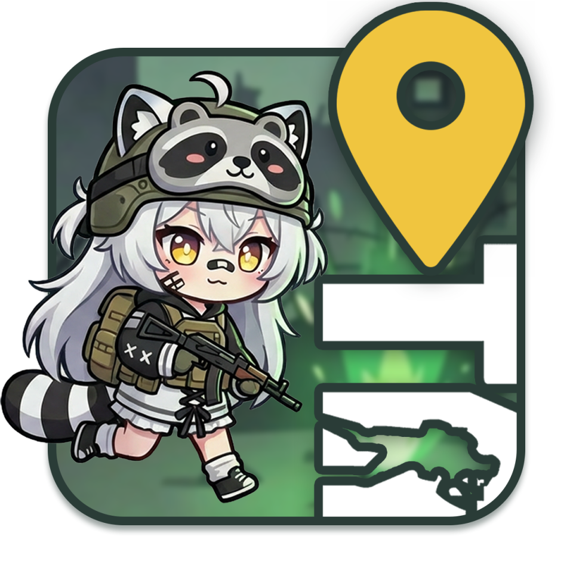
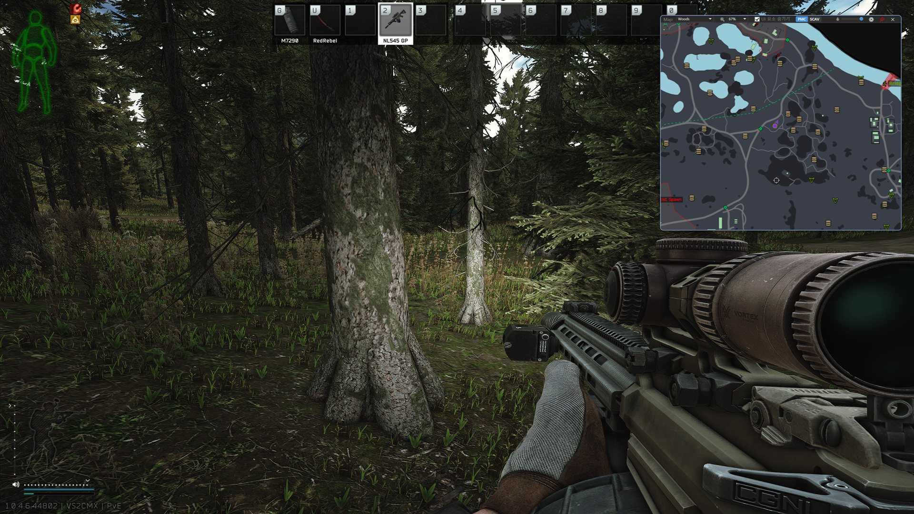

# TanukiTarkovMap

[한국어](README.md) | **English** | [日本語](README.ja.md)

<div align="center">

</div>

> **An in-game minimap overlay tool for Escape from Tarkov.<br>Take a screenshot, and it detects your coordinates and shows your current position on the minimap.**

TanukiTarkovMap opens the interactive map from [tarkov-market.com](https://tarkov-market.com/pilot) in a window that always stays on top of the game, and shows your current position in real time using the coordinates recorded in your in-game screenshots. Online shows your position and direction over the site map; Local shows them on the bundled map. You can check the map with a single hotkey, without Alt+Tab.



---

## Installation

1. Download the latest Setup installer (`TanukiTarkovMap-Setup-<version>-x64.exe`) from the [Releases page](https://github.com/siakun/TanukiTarkovMap/releases/latest).
2. Run it to install. Updates are applied automatically from then on. You can also turn off automatic updates or roll back to the version you want in Settings.

If you would rather not install it, download the portable version (`TanukiTarkovMap-Portable-<version>-x64.zip`) from the same page, extract it, and run it. The portable version has no installer, so you need to install the VC++ Redistributable listed in the requirements below yourself.

> **Requirements**: Windows 10/11 (x64), [Microsoft Visual C++ 2015-2022 Redistributable (x64)](https://aka.ms/vs/17/release/vc_redist.x64.exe)
>
> The Redistributable is the runtime used by the built-in browser (CefSharp). If it is missing, the Setup installer installs it for you during setup, so there is nothing to prepare; only the portable version needs it installed manually. Without it, the app fails to start with an error saying that `CefSharp.Core.Runtime.dll` could not be loaded.
>
> **Safety**: The app does not read game memory or interfere with the game process. It reads only two things: screenshot file names (only the coordinates in the name, not the image content) and the game logs that record which map you entered. It never modifies game files. See [Background](#background) for how it works.

---

## Usage

1. Launch TanukiTarkovMap. The game's screenshot folder is detected automatically, and you can set it yourself in Settings if needed.
2. When you start the game, the app switches to the map you entered automatically.
3. During the game, show or hide the map window with the hotkey (`F11` by default, configurable in Settings). The hotkey works only while the game is running and the game or the map window has focus, so other programs still receive that key, and closing the game brings the hidden map window back (an experimental feature you can turn off in Settings).
4. Press the in-game screenshot key (`PrtScn` by default) to update your position and direction in Online or Local. If Online reports that position tracking is unavailable, switch to Local in the top bar.

Choose a view mode in the top bar. `Online` opens tarkov-market.com focused on the map and overlays your position and direction, `Local` shows your current position and direction on the map bundled with the app, and `Origin` opens the site as it is, without the app's changes. In `Origin`, `PMC`/`SCAV` and "Hide UI elements" do not apply. The mode you choose is kept the next time you launch the app.

The show/hide hotkey hides the whole minimap window to the tray or shows it again; it does not close the app. To update your position, use the game's Screenshot key. To keep the map above the game on a single monitor, turn on the pin (always on top) in the top bar.

> **Note for Steam users**: Steam's `F12` screenshot is a Steam overlay feature, so it does not record coordinates. Always use the Screenshot key from the game's own settings (Controls). Some players report that the default `PrtScn` does not work; if that happens, rebind it to another key.

In Settings, you can change the hotkey, opacity, UI visibility, automatic map switching, automatic screenshot cleanup, and how updates are applied. The same window also lets you check how much space the browser cache takes up as map tiles pile up, and clear it. If you run into a problem or have a suggestion, please post it on [GitHub Issues](https://github.com/siakun/TanukiTarkovMap/issues).

---

## Features

| Feature | Description |
|---------|-------------|
| Map overlay | Interactive map that always stays on top of the game (Always-on-Top) |
| Real-time position tracking | Updates position and direction in Online and Local from in-game screenshots |
| View modes | Switches in the top bar between Online (the site with position and direction), Local (the bundled map with position and direction), and Origin (the original site) |
| Automatic map switching | Detects the map you entered from the game log and switches to it |
| Global hotkey toggle | Shows or hides the map window with one hotkey (`F11` by default); supports modifier and special keys. Works only while the game or the map window has focus (experimental, on by default) |
| Raid focus mode | During a raid, the map window moves to the opposite side when the mouse touches it on the game's monitor; press Alt at that moment to pause and use it, and the map returns to its place when you close the inventory (experimental, off by default) |
| Opacity control | Makes the window semi-transparent while the top bar is hidden, so it blocks as little of your view as possible |
| UI cleanup | In Online, removes unnecessary elements from the web page so only the map is shown |
| Recent Goons sightings | Shows PvE sighting reports on the map |
| Raid position sharing | Exchanges screenshot positions with friends who entered the raid in your squad and shows them on your map (connects automatically) |
| Update management | Applies new versions automatically, and lets you turn off automatic updates or roll back to an earlier version |
| Display language | Follows the Windows display language by default; picking a language in Settings switches it immediately without a restart |

Recent Goons sightings are off by default and can be turned on in Settings. The Goons spawn by chance, so reports may differ from where they actually appear.

Raid position sharing connects automatically to a server run by the developer, with nothing to enter. People who entered the same raid in the same squad exchange screenshot positions, and your game account ID is sent to the server along with your position. Raids you enter alone are not shared, and other squads in the same raid do not receive your position. A friend's name tag uses the nickname found in your game's party notifications or supplied by someone in the room, or the last four digits of their account ID if none is found. The bottom left shows the sharing party, including yourself, as `InRaid: 3p (name, name, name)`, even before screenshots are taken. It is hidden in solo or local PvE raids, in the menu, or when disconnected.

---

## Background

In Escape from Tarkov, taking an in-game screenshot records the player's world coordinates (X, Y, Z) and camera rotation in the file name. This is an official feature that the developer, Battlestate Games, provides for bug reports, and the app only reads files saved on disk without accessing game memory or the game process.

```
2026-09-09[14-14]_179.10, 3.29, -717.65_0, 0.70710678, 0, 0.70710678_15.67 (0).png
└ date/time ┘     └ position X, Y, Z ┘  └ camera rotation (quaternion) ┘
```

The Pilot page on [tarkov-market.com](https://tarkov-market.com/pilot) takes these coordinates and shows your current position on the map. A web app opened in a browser, however, has structural limits. It cannot directly control operating system windows: it cannot pin itself on top of the game (Always-on-Top), make its window semi-transparent, or toggle with a global hotkey. That is why a desktop client is needed.

Several tools like this already exist. The original is [ggdiam/TarkovPilot](https://github.com/ggdiam/TarkovPilot) (.NET Framework, a tray-only helper), which tarkov-market.com officially detects, and [byeong1/Tarkov-Client](https://github.com/byeong1/Tarkov-Client) from the Korean community wrapped it in Edge WebView2 to show the map inside a window. This project started from the idea behind byeong1's version, but replaced the web view engine with CefSharp and redesigned window control, coordinate sync, and the build pipeline from scratch.

---

## Tech Stack

| Area | Technology |
|------|------------|
| Language, runtime | C#, .NET 8.0 |
| UI | WPF, MVVM (CommunityToolkit.Mvvm), Microsoft.Xaml.Behaviors |
| Web view | CefSharp.Wpf.NETCore (Chromium) |
| Native control | P/Invoke (user32.dll) |
| Web integration | CefSharp JavaScript injection (page cleanup, faction filter) |
| Local map | SVG and ES module minimap, CefSharp folder scheme handler |
| DI | Microsoft.Extensions.DependencyInjection |
| Tray | Hardcodet.NotifyIcon.Wpf |
| Position sharing | ASP.NET Core SignalR (server as a .NET 10 container, SignalR client in the app) |
| Distribution, automatic updates | Velopack, Siakun.AutoUpdate, GitHub Releases |

---

## Technical Implementation

This app does not touch game memory or game files. It works only by reading the screenshot file names and logs that the game writes to disk.

### 1. Showing your position from screenshots

The app watches the game's screenshot folder, and when a new file appears, it reads the coordinates and view direction recorded in the file name. It never opens the image itself. In Online, the app draws the position circle and direction arrow over the site's map; in Local, it draws them on the map bundled with the app. The height in the coordinates also selects the floor you are on.

### 2. Local map that works without the site

Local shows the terrain and floors, the extracts of the selected faction, and your position and direction on the map bundled with the app, without connecting to the site. It exists so that you can still see what you need in a raid when a site change stops the Online display or the site cannot be reached. The bundled map is converted from the site's map data and compared with the site's screen for every map and floor, and the position display is checked by automated tests every time the installers are built.

### 3. Automatic map switching from game logs

When you enter a raid, the game records the map it loaded in its log files. The app reads these logs and switches to the map you entered. The game folder is found automatically from the install information of the official launcher and Steam, and you can set it in Settings if it is not found. If you start the app in the middle of a raid, taking one screenshot in the raid switches to that map.

### 4. A window that stays above the game

A web page cannot stay on top of the game or become semi-transparent, and it cannot receive hotkeys while you are playing. The app uses Windows window features for always-on-top, the semi-transparent window, and hotkeys that work during play, and it opens the map in a Chromium browser built into the app (CefSharp).

### 5. An Online view that keeps only the map

Online opens tarkov-market.com, hides the menus and panels you do not need for reading the map, and shows the extracts of the faction (PMC or SCAV) selected in the top bar. The app applies this by running scripts inside the page. Origin runs no scripts and opens the site as it is.

### 6. Raid position sharing

Friends who enter the same raid in the same squad exchange screenshot positions and see each other on the map. The app learns the current raid and squad from the game log and automatically joins the matching room on a server the developer runs. Whenever someone takes a screenshot, the position is delivered to the others in the room right away. Rooms are separated by a value the game assigns to each squad in each raid, so other squads in the same raid and stream viewers cannot join.

Your position, game account ID, and nickname are sent to the server. The server operator can see the IP, account ID, and last position of connected users. Participation records (account ID, nickname, mode, map, join and leave times) are kept for statistics, but IP addresses and coordinates are not stored. Sharing is a secondary feature, so your own position display keeps working even if the server is down or slow.

### 7. Automatic updates and choosing a version

The installed app checks GitHub Releases for new versions and updates itself. A new version is downloaded after the app starts and applied when you close the app, and only the changed parts are downloaded when possible. If a new version has a problem, you can turn off automatic updates in Settings and roll back to an earlier version. Choosing a version other than the latest also turns off automatic updates, so the next launch does not return to the latest version. Turning on "Get beta versions" under "Experimental features" in Settings also lets you receive pre-release versions.

---

## Development

Building requires Windows and the .NET 10 SDK or later. The app runs on .NET 8 and uses the latest C# compiler for the ViewModels' partial property generation (`LangVersion=preview`).

```powershell
dotnet build src/TanukiTarkovMap.csproj
dotnet publish src/TanukiTarkovMap.csproj -c Release -r win-x64 --self-contained true -o publish
```

The app source is in `src/`. Coordinate calculation, settings, file watching, position sharing and site control are provided by the TanukiTarkovMap.Core package in `src/packages/`. The project file pins its version, and `src/NuGet.Config` restores Core from `packages/` in the same folder and every other dependency from NuGet.org, so no extra account or authentication is needed. The Core DLL is obfuscated with Obfuscar, and its public API and JSON contracts are unchanged. The installers on the Releases page are built from the source of the same tag.

---

## License

The source code is licensed under the [MIT License](LICENSE). The Core package includes the license for its binary; see each NuGet dependency's metadata and notices for its license.

> This project is an unofficial tool and is not affiliated with Battlestate Games or Tarkov Market. It does not read game memory or interfere with the game process; it reads only screenshot file names (without reading the image content) and the game logs that record map names.
